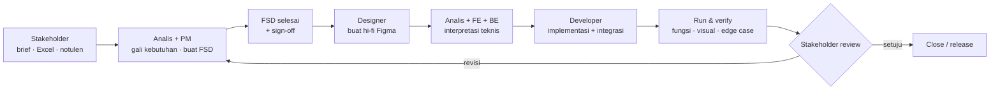

# As-is Workflow — Bspace SDLC

Alur saat ini dari input stakeholder sampai release.



## Peran

| Peran | Aktivitas |
|---|---|
| Stakeholder | Memberi brief, Excel, notulen, dan feedback |
| Analis + PM | Menggali kebutuhan dan menyusun FSD |
| Designer | Membuat desain hi-fi di Figma |
| Analis + FE + BE | Menafsirkan desain menjadi kebutuhan teknis |
| Developer | Implementasi dan integrasi |
| Reviewer | Memeriksa fungsi, visual, dan edge case |

## Titik masalah utama

```text
FSD → langsung hi-fi Figma
```

Wireframe lo-fi belum menjadi tahap standar. Akibatnya:

- Struktur screen dan state belum disepakati lebih awal.
- Designer harus menafsirkan layout dari FSD.
- Revisi dapat muncul setelah desain atau kode dibuat.
- FE/BE kembali menafsirkan desain saat implementasi.

## Alur aktual singkat

1. Stakeholder mengirim kebutuhan dalam format campuran.
2. Analis dan PM mengklarifikasi kebutuhan.
3. Analis membuat FSD.
4. Stakeholder memberi sign-off FSD.
5. Designer membuat hi-fi Figma.
6. Analis, FE, dan BE menyusun interpretasi teknis.
7. Developer mengimplementasikan fitur.
8. Tim menjalankan verifikasi.
9. Stakeholder review.
10. Jika revisi, alur kembali ke analis; jika setuju, fitur ditutup/release.
