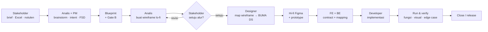

# To-be Workflow — Bspace SDLC

Alur target: kebutuhan disepakati lewat wireframe lo-fi sebelum designer membuat hi-fi.



## Perubahan utama

```text
As-is: FSD → hi-fi Figma
To-be: FSD → lo-fi wireframe → stakeholder approval → hi-fi Figma
```

## Gate hand-off

| Tahap | Output | Gate |
|---|---|---|
| Stakeholder input | Brief, Excel, notulen, SOP | Sumber tercatat |
| Brainstorm + Blueprint | `intent.md`, `sdlc/Blueprint.docx` | G1, Gate B |
| `wireframe-lofi` | `wireframe.md`, grayscale Figma frames, evidence | Stakeholder approval |
| Hi-fi design | Figma BUMA DS + prototype | D0, C1, GD2, P1, G2 |
| Implementasi | Flutter/Vue + API mapping | AC coverage |
| Verify | Test dan visual evidence | Run/fidelity pass |
| Close | `close.md` | Semua AC terisi |

## Pembagian tanggung jawab

- **Analis:** menentukan struktur, field, state, urutan, dan CTA.
- **Stakeholder:** menyetujui alur dan kebutuhan.
- **Designer:** menentukan visual hi-fi, komponen, token, geometry, dan prototype.
- **Developer:** menerjemahkan hi-fi dan kontrak menjadi kode.

Lo-fi menentukan **apa dan urutannya**. Hi-fi menentukan **bagaimana tampilannya**.

## Output setiap skill

Setiap tahap bisa dijalankan user/divisi berbeda. Skill tidak harus dijalankan end-to-end dalam satu sesi.

| Tahap / skill | Owner | Input | Output | Gate / hand-off |
|---|---|---|---|---|
| Stakeholder intake *(standar yang disarankan)* | Stakeholder / PM | Brief, Excel, notulen, SOP | `stakeholder-input/` + sumber terarsip | Sumber dan owner tercatat |
| `blueprint-ftsd` — P0 Discover | Analyst / PM | Input stakeholder | `sdlc/project.md` | Project context lengkap |
| `blueprint-ftsd` — P1 Brainstorm | Analyst | `project.md` + input stakeholder | `intent/<ID>-<slug>/intent.md` | G1: intent approved |
| `blueprint-ftsd` — P2 Data | Analyst / Data owner | Intent fields | `sdlc/data.md` dengan `SRC-xx` | Semua field punya source |
| `blueprint-ftsd` — Blueprint | Analyst + stakeholder | Intent + data | `sdlc/Blueprint.docx`, `Blueprint.md` | Gate B: sign-off + hash |
| `wireframe-lofi` *(skill yang disarankan)* | Analyst / UX | Blueprint + intent | Figma lo-fi, `wireframe.md`, evidence | Stakeholder setuju alur |
| `figma-generate-screen` | Designer | Blueprint + intent + wireframe | Figma hi-fi, `design.md`, `design-evidence/` | D0, C1, GD2, P1, G2 |
| `flutter-slice-screen` / `vue-slice-screen` | FE developer | Intent + design Figma | `spec.md` + screen code | AC coverage |
| `flutter-match-component` | FE developer / DS | Figma + spec | Component mapping + code | BUMA component match |
| `flutter-resolve-assets` / `vue-resolve-assets` | FE developer | Figma + code | Asset mapping | Asset source resolved |
| `flutter-run-verify` | Developer / QA | Implemented screen + API contract | Run evidence + `plan.md` result | App runs; tests pass |
| `flutter-verify-fidelity` | Developer / QA / designer | App + Figma reference | `score.json` + visual evidence | Fidelity pass |
| Close | Analyst / QA / lead | All artifacts + AC results | `close.md` | Semua AC terisi |

## Kontrak hand-off

Setiap skill wajib meninggalkan lima hal:

```text
Input source   → file atau URL yang dibaca
Output         → file/Figma node yang dibuat
Owner          → divisi/user yang bertanggung jawab
Status         → draft / approved / blocked / pass
Next gate      → pemeriksaan yang harus lulus berikutnya
```

Contoh hand-off Designer ke Developer:

```text
Input:  intent/ATT-attendance/intent.md + wireframe Figma
Output: intent/ATT-attendance/design.md + Figma hi-fi node URL
Owner:  Designer
Status: G2 pass
Next:   flutter-slice-screen
```

## Bisa dipisah per user atau divisi?

**Bisa.** Syaratnya semua user memakai project folder atau ZIP yang sama, dengan nama artefak tetap.

```text
Stakeholder → paket input
Analyst      → intent + data + Blueprint
UX/Analyst   → wireframe lo-fi
Designer     → hi-fi Figma + design.md
FE Developer → spec.md + code
QA/Designer  → run/fidelity evidence
Lead         → close.md
```

User berikutnya tidak perlu mengulang tahap sebelumnya. Mereka cukup:

1. Membuka project folder.
2. Membaca output skill sebelumnya.
3. Menjalankan gate.
4. Memperbaiki hanya item yang gagal.
5. Menulis output tahapnya.

Router `using-bspace-sdlc` hanya diperlukan saat ingin mencari tahap berikutnya otomatis. Skill individual tetap dapat dipanggil langsung menggunakan path artefak.

## Contoh pembagian sesi

```text
Sesi 1 — Stakeholder
  stakeholder-input/ ✓

Sesi 2 — Analyst
  project.md → intent.md → data.md → Blueprint.docx ✓

Sesi 3 — Stakeholder + Analyst
  Gate B ✓

Sesi 4 — Analyst / UX
  wireframe Figma + approval ✓

Sesi 5 — Designer
  design.md + hi-fi Figma + G2 ✓

Sesi 6 — FE developer
  spec.md + implementation ✓

Sesi 7 — QA / designer
  run + fidelity + close ✓
```

Jadi workflow tetap satu secara artefak, tetapi pelaksanaannya dapat terpisah secara role, divisi, user, hari, atau sesi.

